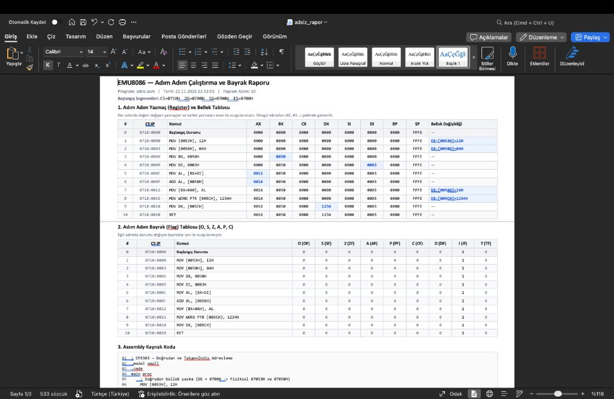

# Emu8086 for Mac & Web

Mikroişlemciler dersi için **emu8086**'ya yerel **macOS** ve **Online Web (Tarayıcı / PWA)** alternatifi olarak sıfırdan **saf TypeScript** ile geliştirilmiş, harici emülatör kütüphanesi kullanmayan eğitim amaçlı Intel 8086 emülatörü ve adım adım hata ayıklayıcısı (debugger).

**Web tarayıcıları (Windows, macOS, Linux, iPad/Tablet)**, **Apple Silicon (M1–M4)** ve **Intel Mac** uyumludur. Arayüz **Türkçe / İngilizce (TR | EN)**, **Açık / Koyu** tema ve **Sıkı / Esnek emu8086 Uyumluluk Modu** seçeneklidir.

---

## Ekran Görüntüleri

| Koyu Tema (Türkçe) — Kod, Yazmaçlar & 1 MB Bellek | Açık Tema (English) — Tek Adım & Bayrak Takibi |
| :---: | :---: |
|  |  |

| Uygulama İçi Adım Tablosu Önizleme | Otomatik Word (`.docx`) Ödev Raporu Çıktısı |
| :---: | :---: |
|  |  |

---

## Özellikler

- **Sıfırdan 8086 Çekirdeği:** 1 MB düz bellek (`Uint8Array`), `(Segment << 4) + Offset` fiziksel adresleme, Little-Endian 16-bit bellek erişimi, gerçekçi Intel 8086 komut uzunlukları (`CS:IP`) ve bağımsız 8/16-bit yazmaçlar (`AX–DX` / `AH–DL`, `SP`, `BP`, `SI`, `DI`, `IP`, `CS`, `DS`, `SS`, `ES`).
- **Intel 8086 Bayrak Mantığı:** `OF`, `SF`, `ZF`, `AF`, `PF`, `CF` (ve `DF`, `IF`, `TF`) bayrakları her aritmetik/mantık komutunda Intel 8086 kurallarına göre güncellenir (`PF` yalnızca en düşük 8 biti denetler, `INC`/`DEC` `CF`'yi korur, `MOV` bayrakları değiştirmez, kaydırma/döndürme komutları gerçek 8086 8-bit `CL` sayacını kullanır).
- **Sıkı / Esnek `emu8086` Uyumluluk Modu:**
  - **Sıkı Mod (Açık):** Gerçek Windows `emu8086` derleyicisi gibi belirsiz bellek boyutlarını (`BYTE PTR` / `WORD PTR` eksikliği), sabit değer taşmalarını (`MOV AL, 300`) ve değişken boyut uyuşmazlıklarını derleme zamanında yakalar.
  - **Esnek Mod:** Ders slaytlarındaki kısaltılmış kullanımları (`MOV [0058H], 04H` gibi) sarı açıklamalı **Uyarı** ile çalıştırır ve öğrenciyi doğru sözdizimine yönlendirir.
- **Etkileşimli Hata Ayıklama & Klavye/Ekran Kesmeleri:** **Tek Adım** (`F8`), **Geri Al / Step Back** (`F7`), **Çalıştır** (`F9` — Anlık / Normal / Yavaş hız), `INT 21H` (`AH=01H/07H/08H/0AH`) ve `INT 16H` (`AH=00H`) için canlı klavye girdisi, `INT 10H` (`AH=0EH`) ve `INT 21H` (`AH=02H/09H`) konsol çıktısı.
- **Ödev İçin Word (`.docx`) Raporu:** **Tablo Kaydı** açıkken çalıştırılan her adım — döngü tekrarları (`#2`, `#3`…), segment ve bellek değişimleri dahil — kaydedilir; tek tıkla yatay (Landscape) Word dosyasına **Yazmaç & Bellek Tablosu**, **Bayrak Tablosu** ve **Kaynak Kod** olarak aktarılır.
- **Hem Web Hem Masaüstü:**
  - **Web Sürümü:** Kurulum gerektirmez, otomatik taslak kaydı (`localStorage`), tek tıkla **Link ile Kod Paylaşımı (`#code=...`)** ve çevrimdışı (PWA) çalışma desteği sunar.
  - **macOS Masaüstü Sürümü:** Yerel `.asm` dosya diyalogları, kaydedilmemiş değişiklik koruması ve Finder entegrasyonu.

---

## Kurulum ve Çalıştırma

### 1) Hazır macOS Uygulaması (`.dmg`) ile Kurulum
1. [GitHub Releases](https://github.com/CelalTurkoglu/Emu8086_for_Mac/releases) sayfasından `EMU8086 Mac-0.2.0-universal.dmg` dosyasını indirin.
2. `.dmg` dosyasını açıp **EMU8086 Mac** uygulamasını **Applications (Uygulamalar)** klasörüne sürükleyin.

> **macOS İlk Açılış Notu:** Uygulama Apple Developer hesabı olmadan yerel ad-hoc imza ile derlendiği için internetten indirildiğinde macOS *"doğrulanamadı / hasarlı"* uyarısı gösterebilir.  
> **Sistem Ayarları → Gizlilik ve Güvenlik → Yine de Aç** seçeneğini kullanabilir veya Terminal'de tek seferlik şu komutu çalıştırabilirsiniz:
> ```bash
> xattr -cr "/Applications/EMU8086 Mac.app"
> ```

### 2) Kaynak Koddan Çalıştırma (Web & Masaüstü)
Gereksinimler: **Node.js 20+** ve **npm**.

```bash
git clone https://github.com/CelalTurkoglu/Emu8086_for_Mac.git
cd Emu8086_for_Mac
npm install

# Sadece Web sürümünü tarayıcıda başlat (http://localhost:5173)
npm run dev:vite

# Masaüstü (Electron) uygulamasını geliştirme modunda başlat
npm run dev

# Birim ve güvenlik testlerini çalıştır
npm test

# Online yayın için statik Web paketi üret (dist/ klasörüne yazar — Vercel / Cloudflare / GitHub Pages uyumlu)
npm run build:web
npm run preview:web

# Universal macOS .app / .dmg / .zip paketi üret (release/ klasörüne yazar)
npm run pack:mac:universal
```

---

## Nasıl Kullanılır?

1. **Kodu Hazırlayın:** Editöre assembly kodunuzu yazın, üst bardan hazır **Ders Örnekleri**nden birini seçin, `.asm` dosyanızı açın veya pencereye sürükleyip bırakın.
2. **Sıkı / Esnek Modu Seçin:** Kodunuzu gerçek Windows `emu8086` kurallarıyla sınamak için üst bardaki **Sıkı Mod** düğmesini kullanın.
3. **Derle / Yükle (`⌘B` / `Ctrl+B`):** Kod ayrıştırılır, komutlar `CS:IP` adreslerine ve `.data` değişkenleri `DS:0000H` adresinden itibaren belleğe yüklenir.
4. **Adım Adım İzleyin:** **Tek Adım (`F8`)** ile her komutta yazmaç, bayrak ve bellek değişimlerini inceleyin; **Geri Al (`F7`)** ile önceki adıma dönün veya **Çalıştır (`F9`)** ile programı çalıştırın.
5. **Ödev Raporu (Word `.docx`):**
   - Üst araç çubuğundaki **Tablo Kaydı** düğmesini açın.
   - Programı **Tek Adım** veya **Çalıştır** ile yürütün (döngüdeki her tur sırayla kaydedilir).
   - **Tabloyu Gör** ile tabloları kontrol edip **Word (`.docx`)** (`⌘E` / `Ctrl+E`) ile kaydedin.

| Kısayol | İşlev |
| --- | --- |
| `⌘B` / `Ctrl+B` | Derle / Yükle |
| `F8` / `F7` | Tek Adım / Geri Al |
| `F9` | Çalıştır / Durdur |
| `⌘N` / `Ctrl+N` | Yeni Dosya |
| `⌘O` / `Ctrl+O` | `.asm` Dosyası Aç |
| `⌘S` / `⌘⇧S` | Kaydet / Farklı Kaydet |
| `⌘E` / `Ctrl+E` | Tabloyu Word (`.docx`) Olarak Aktar |

---

## Desteklenen Sözdizimi, Komutlar ve Kesmeler

- **Yönergeler & İfadeler:** `ORG 100h`, `.model small`, `.stack`, `.data`, `.code`, `DATA SEGMENT ... DATA ENDS`, `CODE SEGMENT ... CODE ENDS`, `ASSUME`, `main proc`, `endp`, `end main`, `DB`, `DW`, `DD`, `DUP` (iç içe ve çoklu değer destekli), `EQU`, `OFFSET`, `SEG`, `@DATA`, `@CODE`, `$` konum sayacı (`LEN EQU $ - MSG`), sabit aritmetik ifadeleri (`'0' + 5`, `DATA1 + 2`), `.exit`
- **Adresleme Modları:** Anlık (`MOV AX, 5`), Yazmaç (`MOV AX, BX`), Doğrudan Bellek (`MOV BYTE PTR [0058H], 04H`), Dolaylı (`[BX]`, `[SI]`, `[DI]`, `[BP]`), Taban+İndis (`[BX+DI]`, `[BX][DI]`, `[BX]+[SI]`, `[BX]+2`), Göreli (`ARRAY[SI+2]`, `DATA1+2`), Segment Geçersiz Kılma (`DS:[1234H]`, `ES:[DI]`), `BYTE PTR` / `WORD PTR` (`b.` / `w.`)
- **Komut Grupları:**
  - **Veri, Tablo & Yığın:** `MOV`, `XCHG`, `LEA`, `LDS`, `LES`, `XLAT` / `XLATB`, `PUSH`, `POP`, `PUSHF`, `POPF`, `PUSHA`, `POPA`, `LAHF`, `SAHF`, `CBW`, `CWD`
  - **Aritmetik & BCD:** `ADD`, `ADC`, `SUB`, `SBB`, `INC`, `DEC`, `NEG`, `CMP`, `MUL`, `IMUL`, `DIV`, `IDIV`, `DAA`, `DAS`, `AAA`, `AAS`, `AAM`, `AAD`
  - **Mantık, Kaydırma & Döndürme:** `AND`, `OR`, `XOR`, `NOT`, `TEST`, `SHL`, `SAL`, `SHR`, `SAR`, `ROL`, `ROR`, `RCL`, `RCR`
  - **Kontrol Akışı & Dallanma:** `JMP` (doğrudan, yazmaç ve `JMP TABLE[BX]` dolaylı bellek dahil), `JZ/JE`, `JNZ/JNE`, `JC/JB/JNAE`, `JNC/JAE/JNB`, `JA/JNBE`, `JBE/JNA`, `JG/JNLE`, `JGE/JNL`, `JL/JNGE`, `JLE/JNG`, `JO`, `JNO`, `JS`, `JNS`, `JP/JPE`, `JNP/JPO`, `JCXZ`, `LOOP`, `LOOPE/LOOPZ`, `LOOPNE/LOOPNZ`, `CALL` (etiket, yazmaç ve dolaylı bellek dahil), `RET`, `RETN`, `RETF`, `IRET`, `INTO`, `HLT`, `NOP`
  - **Dizi & Bayrak Kontrolü:** `CLD`, `STD`, `CLC`, `STC`, `CMC`, `CLI`, `STI`, `REP`/`REPE`/`REPZ`/`REPNE`/`REPNZ` + `MOVSB`, `MOVSW`, `STOSB`, `STOSW`, `LODSB`, `LODSW`, `SCASB`, `SCASW`, `CMPSB`, `CMPSW`
  - **Kesmeler (BIOS & DOS):**
    - `INT 20H`: Programı sonlandır
    - `INT 21H`: `AH=00H/4CH` (çıkış), `AH=01H` (yankılı karakter okuma), `AH=02H` (karakter yazdırma), `AH=06H` (doğrudan konsol G/Ç), `AH=07H/08H` (yankısız karakter okuma), `AH=09H` (`$` bitimli metin yazdırma), `AH=0AH` (tamponlu satır okuma), `AH=2AH` (sistem tarihi), `AH=2CH` (sistem saati)
    - `INT 10H`: `AH=0EH` (Teletype karakter yazdırma), `AH=00H` (ekran temizleme)
    - `INT 16H`: `AH=00H/10H` (klavyeden tuş bekleme), `AH=01H/11H` (tuş durumu kontrolü)

### Bilinen Sınırlamalar (emu8086 Farkları)
- Sanal donanım aygıtları (`IN` / `OUT` portlarına bağlı trafik ışığı, step motor, termometre vb.) ve harici `include 'emu8086.inc'` makro kütüphanesi bu eğitim emülatörünün kapsamı dışındadır.
- Desteklenmeyen bir BIOS/DOS kesmesi çağrıldığında emülatör sessizce hata gizlemek yerine tanılama panelinde bilgilendirici bir uyarı gösterir.

---

## Lisans

Bu proje [MIT Lisansı](LICENSE) ile lisanslanmıştır. Kaynak kodunu ve uygulamayı özgürce kullanabilir, paylaşabilir ve geliştirebilirsiniz.
