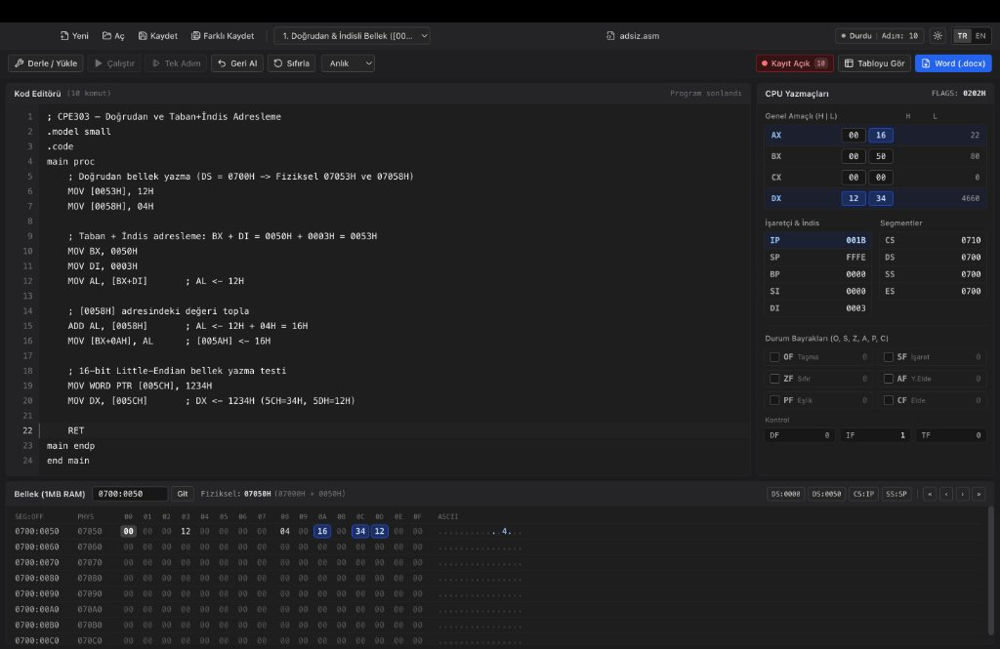
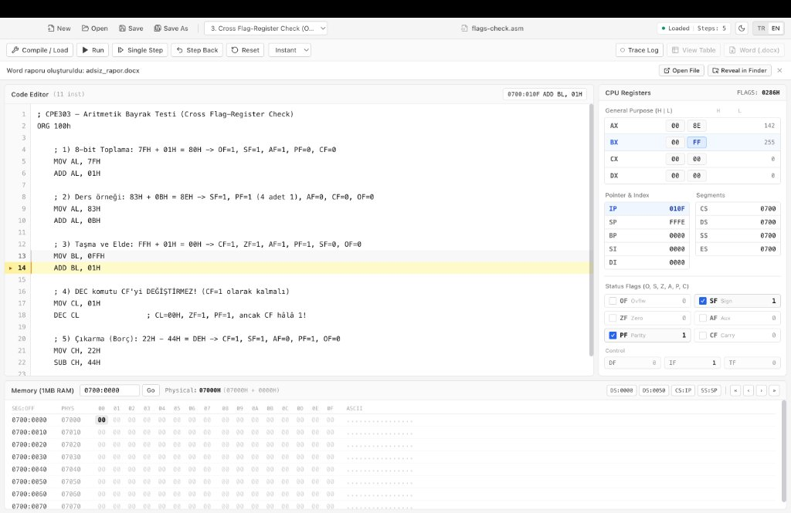
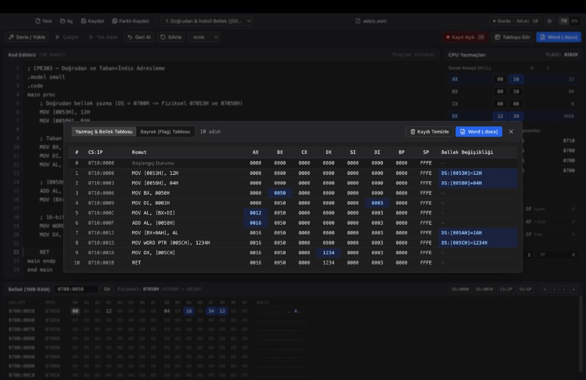

# Emu8086 for Mac

Mikroişlemciler dersi için **emu8086**'ya yerel macOS alternatifi olarak sıfırdan **saf TypeScript** ile geliştirilmiş, harici emülatör kütüphanesi kullanmayan eğitim amaçlı Intel 8086 emülatörü ve adım adım hata ayıklayıcısı (debugger).

**Apple Silicon (M1–M4)** ve **Intel Mac** uyumludur. Arayüz **Türkçe / İngilizce (TR | EN)** ve **Açık / Koyu** tema seçeneklidir.

---

## Ekran Görüntüleri

| Koyu Tema (Türkçe) — Kod, Yazmaçlar & 1 MB Bellek | Açık Tema (English) — Tek Adım & Bayrak Takibi |
| :---: | :---: |
|  |  |

| Uygulama İçi Adım Tablosu Önizleme | Otomatik Word (`.docx`) Ödev Raporu Çıktısı |
| :---: | :---: |
|  |  |

---

## Özellikler

- **Sıfırdan 8086 Çekirdeği:** 1 MB düz bellek (`Uint8Array`), `(Segment << 4) + Offset` fiziksel adresleme, Little-Endian 16-bit bellek erişimi ve bağımsız 8/16-bit yazmaçlar (`AX–DX` / `AH–DL`, `SP`, `BP`, `SI`, `DI`, `IP`, `CS`, `DS`, `SS`, `ES`).
- **Intel 8086 Bayrak Mantığı:** `OF`, `SF`, `ZF`, `AF`, `PF`, `CF` (ve `DF`, `IF`, `TF`) bayrakları her aritmetik/mantık komutunda Intel 8086 kurallarına göre güncellenir (`PF` yalnızca en düşük 8 biti denetler, `INC`/`DEC` `CF`'yi korur, `MOV` bayrakları değiştirmez).
- **Etkileşimli Hata Ayıklama:** **Tek Adım** (`F8`), **Geri Al / Step Back** (`F7`), **Çalıştır** (`F9` — Anlık / Normal / Yavaş hız), aktif `CS:IP` satır vurgusu ve tıklayarak doğrudan düzenlenebilen 1 MB Hex/ASCII bellek görüntüleyici.
- **Ödev İçin Word (`.docx`) Raporu:** **Tablo Kaydı** açıkken çalıştırılan her adım — döngü tekrarları (`#2`, `#3`…) dahil — kaydedilir; tek tıkla yatay (Landscape) Word dosyasına **Yazmaç & Bellek Tablosu**, **Bayrak Tablosu** ve **Kaynak Kod** olarak aktarılır.
- **Yerel Dosya İşlemleri:** `.asm` dosya açma (`⌘O`), kaydetme (`⌘S`), farklı kaydetme (`⌘⇧S`), sürükle-bırak ve 6 hazır ders örneği.

---

## Kurulum

### 1) Hazır Uygulama (`.dmg`) ile Kurulum
1. [GitHub Releases](https://github.com/CelalTurkoglu/Emu8086_for_Mac/releases) sayfasından `EMU8086 Mac-0.1.0-universal.dmg` dosyasını indirin.
2. `.dmg` dosyasını açıp **EMU8086 Mac** uygulamasını **Applications (Uygulamalar)** klasörüne sürükleyin.

> **macOS İlk Açılış Notu:** Uygulama Apple Developer hesabı olmadan yerel ad-hoc imza ile derlendiği için internetten indirildiğinde macOS *"doğrulanamadı / hasarlı"* uyarısı gösterebilir.  
> **Sistem Ayarları → Gizlilik ve Güvenlik → Yine de Aç** seçeneğini kullanabilir veya Terminal'de tek seferlik şu komutu çalıştırabilirsiniz:
> ```bash
> xattr -cr "/Applications/EMU8086 Mac.app"
> ```

### 2) Kaynak Koddan Çalıştırma ve Paketleme
Gereksinimler: **Node.js 20+** ve **npm**.

```bash
git clone https://github.com/CelalTurkoglu/Emu8086_for_Mac.git
cd Emu8086_for_Mac
npm install

# Geliştirme modunda masaüstü uygulamasını başlat
npm run dev

# Birim testlerini çalıştır (ALU, bayraklar, parser, döngü & .docx testi)
npm test

# Universal macOS .app / .dmg / .zip paketi üret (release/ klasörüne yazar)
npm run pack:mac:universal
```

*(Sadece Apple Silicon için daha küçük boyutlu paket: `npm run pack:mac`)*

---

## Nasıl Kullanılır?

1. **Kodu Hazırlayın:** Editöre assembly kodunuzu yazın, üst bardan hazır **Ders Örnekleri**nden birini seçin veya `.asm` dosyanızı açın / pencereye sürükleyip bırakın.
2. **Derle / Yükle (`⌘B`):** Kod ayrıştırılır, `.data` değişkenleri `DS:0000H` adresinden itibaren belleğe yüklenir ve `CS:IP` başlangıç komutuna ayarlanır.
3. **Adım Adım İzleyin:** **Tek Adım (`F8`)** ile her komutta yazmaç, bayrak ve bellek değişimlerini inceleyin; **Geri Al (`F7`)** ile önceki adıma dönün veya **Çalıştır (`F9`)** ile programı çalıştırın.
4. **Ödev Raporu (Word `.docx`):**
   - Üst araç çubuğundaki **Tablo Kaydı** düğmesini açın.
   - Programı **Tek Adım** veya **Çalıştır** ile yürütün (döngüdeki her tur sırayla kaydedilir).
   - **Tabloyu Gör** ile tabloları kontrol edip **Word (`.docx`)** (`⌘E`) ile kaydedin.

| Kısayol | İşlev |
| --- | --- |
| `⌘B` | Derle / Yükle |
| `F8` / `F7` | Tek Adım / Geri Al |
| `F9` | Çalıştır / Durdur |
| `⌘N` / `⌘O` | Yeni / `.asm` Aç |
| `⌘S` / `⌘⇧S` | Kaydet / Farklı Kaydet |
| `⌘E` | Tabloyu Word (`.docx`) Olarak Aktar |

---

## Nasıl Çalışır? (Mimari & Teknik Detaylar)

Emülatör motoru arayüzden tamamen bağımsız (`src/core/`) saf TypeScript modülleri olarak çalışır:

```text
Assembly Kaynak Kodu (.asm)
  │
  ▼  1. İki Geçişli Parser (src/core/parser.ts)
  │     • Direktif çözümleme (ORG 100h, .model small, .data, .code, proc/endp)
  │     • Sembol / etiket tablosu (ileri yönlü dallanmalar, EQU, DB/DW/DD)
  │     • Komut AST ve adresleme modu ayrıştırma
  ▼
  │  2. Yürütme Motoru (src/core/executor.ts)
  │     • CS:IP üzerinden komut yürütme + çağrı derinliği ve yığın yönetimi
  │     • Tersine çevrilebilir bellek günlüğü (Step Back) ve adım kaydı (Trace)
  ▼
  ├──► ALU & Bayraklar (src/core/alu.ts)      → 8/16-bit aritmetik, mantık, kaydırma ve 8086 bayrakları
  ├──► Yazmaç Dosyası (src/core/registers.ts) → 16-bit / H-L 8-bit bit maskeli senkron erişim
  ├──► 1 MB Bellek (src/core/memory.ts)       → Uint8Array(0x100000), (Seg << 4) + Off, Little-Endian
  └──► Word Üretici (src/core/docxExporter.ts)→ Kaydedilen adımlardan .docx tablo raporu
```

### Desteklenen Sözdizimi ve Komutlar
- **Yönergeler:** `ORG 100h`, `.model small`, `.data`, `.code`, `main proc`, `endp`, `end main`, `DB`, `DW`, `DD`, `DUP`, `EQU`, `OFFSET`, `@DATA`, `.exit`
- **Adresleme Modları:** Anlık (`MOV AX, 5`), Yazmaç (`MOV AX, BX`), Doğrudan Bellek (`MOV [0058H], 04H`), Dolaylı (`[BX]`, `[SI]`, `[DI]`, `[BP]`), Taban+İndis (`[BX+DI]`, `[BX][DI]`), Göreli (`ARRAY[SI+2]`), Segment Geçersiz Kılma (`DS:[1234H]`), `BYTE PTR` / `WORD PTR` (`b.` / `w.`)
- **Komut Grupları:**
  - Veri & Yığın: `MOV`, `XCHG`, `LEA`, `PUSH`, `POP`, `CBW`, `CWD`
  - Aritmetik: `ADD`, `ADC`, `SUB`, `SBB`, `INC`, `DEC`, `NEG`, `CMP`, `MUL`, `IMUL`, `DIV`, `IDIV`, `DAA`, `DAS`
  - Mantık & Kaydırma: `AND`, `OR`, `XOR`, `NOT`, `TEST`, `SHL/SAL`, `SHR`, `SAR`, `ROL`, `ROR`, `RCL`, `RCR`
  - Kontrol Akışı: `JMP`, `JZ/JE`, `JNZ/JNE`, `JC/JB`, `JNC/JAE`, `JA`, `JBE`, `JG`, `JGE`, `JL`, `JLE`, `JO`, `JNO`, `JS`, `JNS`, `JP`, `JNP`, `LOOP`, `LOOPE`, `LOOPNE`, `CALL`, `RET`, `HLT`, `NOP`
  - Dizi & Kesme: `CLD`, `STD`, `CLC`, `STC`, `CMC`, `REP`/`REPE`/`REPNE` + `SCASB`, `CMPSB`, `MOVSB`, `STOSB`, `LODSB`, `INT 20H`, `INT 21H` (`AH=00H/02H/09H/4CH`)
- **Varsayılan Segment Düzeni (emu8086 uyumlu):** `ORG 100h` için `CS=DS=SS=ES=0700H`, `IP=0100H`, `SP=FFFEH`; `.model small` için `CS=0710H`, `IP=0000H`, `DS=SS=ES=0700H`.

### Teknoloji Yığını
- **Çekirdek:** TypeScript (sıfırdan, harici emülatör yok)
- **Arayüz:** React 18, Tailwind CSS, Lucide Icons, `docx`
- **Masaüstü & Test:** Electron 33, Vite 6, Vitest, `electron-builder`

---

## Klasör Yapısı

```text
Emu8086_for_Mac/
├── electron/               # Electron ana süreç, macOS menü & dosya IPC köprüsü
│   ├── main.ts
│   └── preload.ts
├── src/
│   ├── core/               # Saf TypeScript 8086 emülatör çekirdeği
│   │   ├── types.ts        # CPU, Bellek, Yazmaç, Bayrak ve AST arayüzleri
│   │   ├── memory.ts       # 1 MB düz bellek ve fiziksel adres hesabı
│   │   ├── registers.ts    # 16/8-bit yazmaçlar ve FLAGS biti paketleme
│   │   ├── cpu.ts          # CPU durumu ve yığın (push16/pop16)
│   │   ├── alu.ts          # Aritmetik/mantık ALU ve Intel 8086 bayrak kuralları
│   │   ├── parser.ts       # İki geçişli assembly ayrıştırıcı
│   │   ├── executor.ts     # Komut yürütücü, Step Back ve adım kaydı (trace)
│   │   └── docxExporter.ts # Adım adım Word (.docx) ödev raporu üretici
│   ├── components/         # React arayüz panelleri (TopBar, CodeEditor, RegistersPanel, MemoryViewer, TraceModal)
│   ├── data/examples.ts    # Hazır ders örnekleri
│   ├── i18n/               # Türkçe (tr) ve İngilizce (en) dil dosyaları
│   └── App.tsx
├── tests/                  # Vitest birim testleri (CPU, ALU/bayraklar, parser, .docx)
├── build/                  # macOS uygulama ikonu (.icns) ve imzalama/paketleme betikleri
├── docs/screenshots/       # README ekran görüntüleri
├── LICENSE                 # MIT Lisansı
└── package.json
```

---

## Lisans

Bu proje [MIT Lisansı](LICENSE) ile lisanslanmıştır. Kaynak kodunu ve uygulamayı özgürce kullanabilir, paylaşabilir ve geliştirebilirsiniz.
